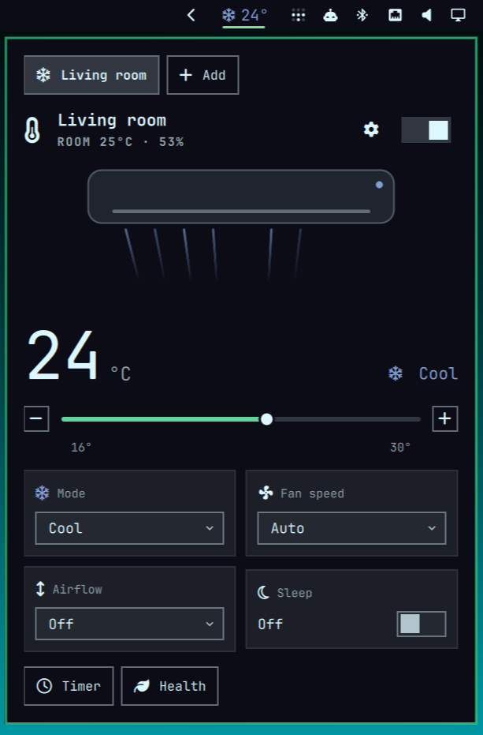

# omarchy-aircon

Control your air conditioner from the [Omarchy](https://omarchy.org/) status bar.
No cloud, no phone app, no hunting for the remote.

<p align="center">
  
</p>

## What it does

- Shows your air conditioner in the bar: mode and target temperature at a glance.
- One click opens a panel with temperature, mode, fan speed, airflow, sleep and a timer.
- Matches your Omarchy theme, and follows it when you switch themes.
- Talks to the air conditioner directly on your home network.
- Handles several air conditioners, one tab each.
- Adds quick actions to the Omarchy menu.

## Supported air conditioners

- **Haier** units with the SmartAir2 USB Wi-Fi module (the one paired with the
  HaierSmartAir2 app).

Yours isn't listed? See [Add your air conditioner](#add-your-air-conditioner).

## Install

```bash
omarchy plugin add https://github.com/seromenho/omarchy-aircon --enable
```

Then click the new icon in the bar:

1. **Finish install**: sets up the small background service (a few seconds, no password).
2. **Find your air conditioner**: the panel looks for it on your network; pick yours and give
   it a name. Use **+ Add** for more rooms.

To update later: `omarchy plugin update aircon`. The widget picks up the new version by itself.

> **Haier:** pair the unit's Wi-Fi module once with the HaierSmartAir2 app first. After that,
> neither the app nor the internet is needed.

## Add your air conditioner

aircon is built around pluggable backends, so another brand or protocol (Midea, Gree, Daikin,
Tuya-based units, an ESPHome board, …) is one module away. The panel, the timer, the menu and
everything else work with any backend.

Open a coding agent (Claude Code, Codex, Cursor, …) in this repository and ask:

> Add support for my Midea air conditioner

It already knows the way: it asks you a few questions, looks for how your unit can be
controlled locally, builds and tests the backend without touching your air conditioner, and
only tries it on the real unit when you say so. (If your agent doesn't read `AGENTS.md` on its
own, point it to [docs/adding-a-backend.md](docs/adding-a-backend.md).)

Got it working? A pull request is very welcome.

## More

- [Reference](docs/reference.md): command line, configuration file, socket API, how it works.
- [AGENTS.md](AGENTS.md): how the code is organised and the rules for contributing.

## Credits

The Haier protocol was worked out by the community, notably
[bstuff/haier-ac-remote](https://github.com/bstuff/haier-ac-remote) and the
[ESPHome Haier component](https://esphome.io/components/climate/haier/).

## License

[MIT](LICENSE)
